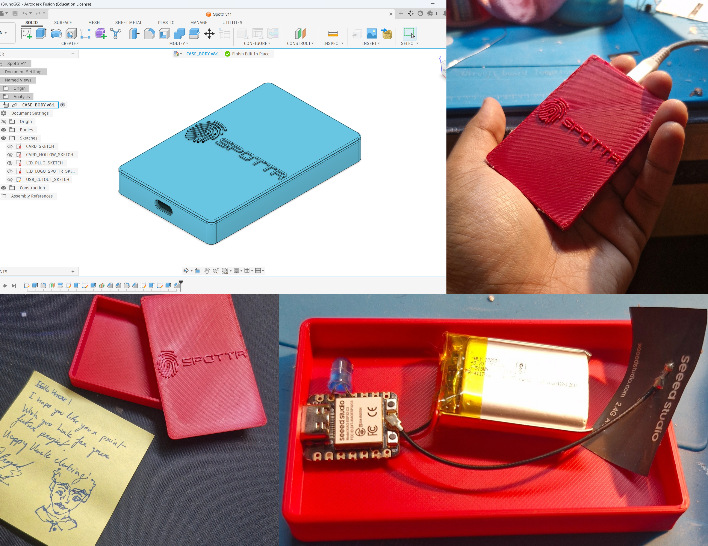
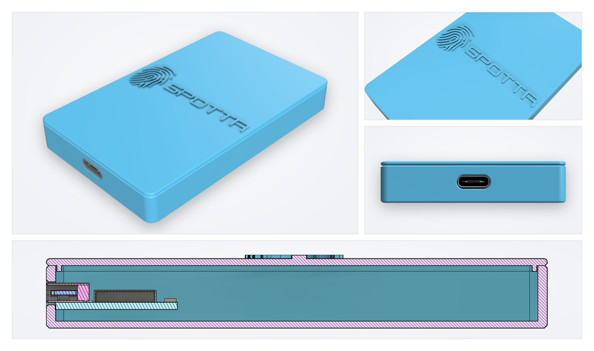
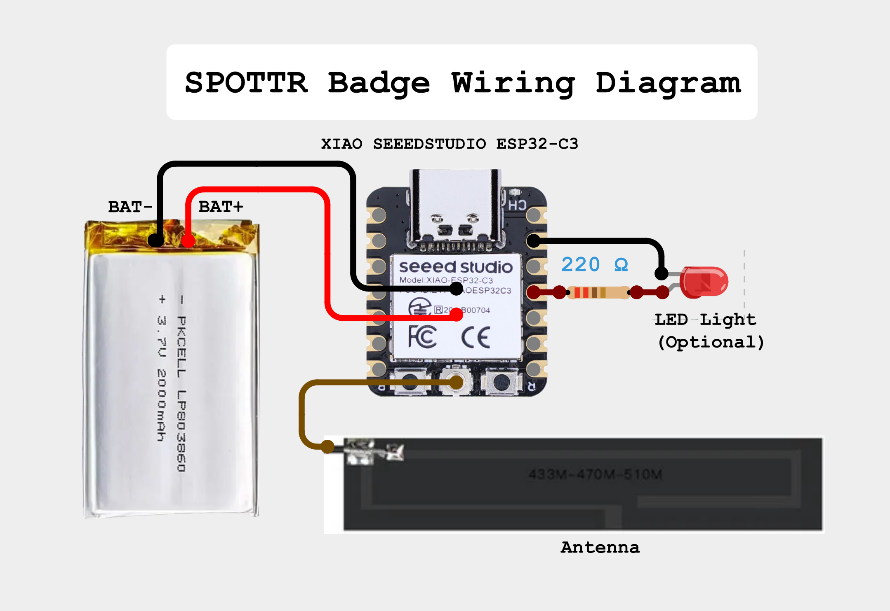
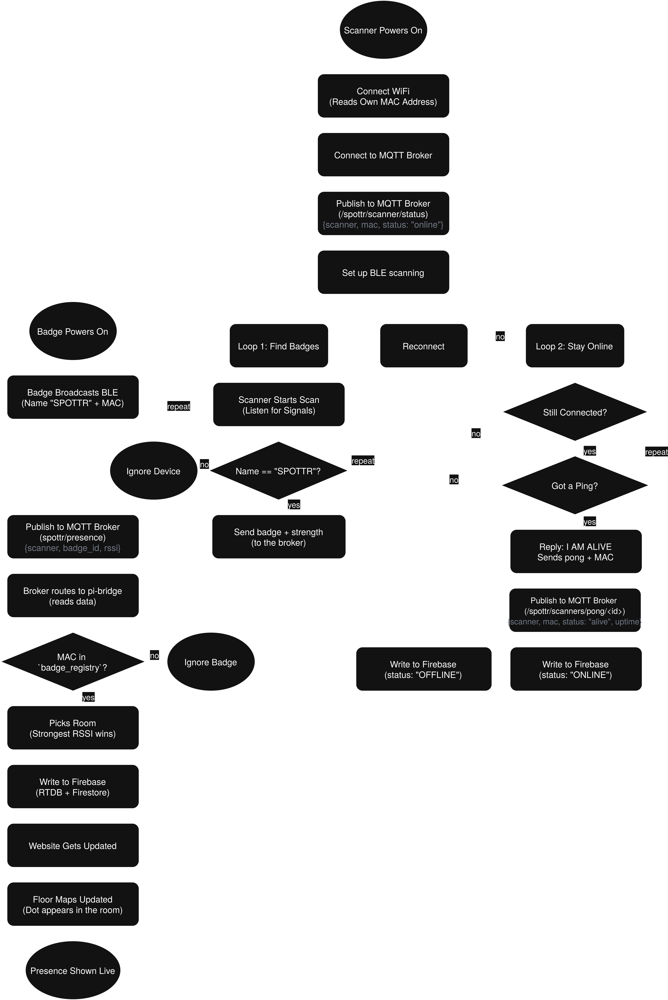

  

# SPOTTR: Real-time BLE Presence Tracking using ESP32

SPOTTR is an open-source indoor presence tracking system built on a cheap aah microcontroller (ESP32-C3 & ESP32-C6) and Bluetooth Low Energy. This project has multiple applications as it can be used in schools, offices, warehouses or even hospitals.

I started building this project because of one problem, no one can accurately track someone inside a closed building or space while also keeping a head count. I saw this problem at my school. Every time we went to the field, they had to do a manual roll call, and then another one once we were back in class. The school also had no way to find someone when they needed to. We only knew that someone was inside the building, not where exactly they were.

  

## Features

- **Wearable BLE Badges**
- **Room Level Detection**
- **Scanner to Cloud Bridge**
- **Live Floor Map**

## Hardware Components Used

- **ESP32-C3**
- **LiPo Battery**
- **ESP32-C6**

## Demo
https://youtu.be/ntAMRt7f-G8

## Renders

A 3D-printable, card-format enclosure for the badge, designed in Fusion 360 to fit the board and battery.

## Wiring Diagram

Wiring for the badge. 
> **The LED used here is optional and can be excluded. Note that not using the LED would definitely improve the battery life of the badges**

## Flow Chart

## Setup Guide:

The setup guide covers flashing the badges and scanners, getting the bridge running, and connecting the dashboard.

Checkout the [Setup Guide](docs/SETUP_PROJECT.md)

## License

This project is licensed under AGPL-3.0, so you are free to use, modify, and share it, as long as any modified version you distribute or run as a service is also open-source.

AGPL-3.0 © 2026 Prathamesh Prabhakar

## AI Declaration

The creation of this project has been assisted by AI. Components such as a few parts of frontend are AI assisted. Backend, firmware I've used code suggestions (Github Copilot) in the creation process.

> **Note: Spottr is currently under active development. Stay tuned for more stuff to be added**
